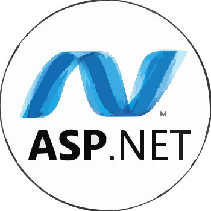
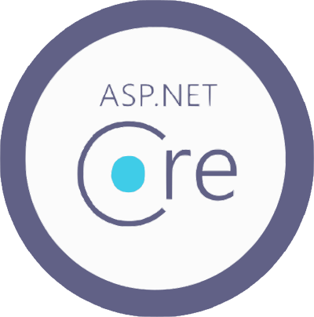
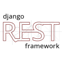
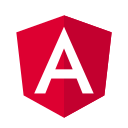
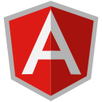

    

## 🌐 Social Media & Developer Platforms

  
  
  
  
  
  
  
  
  
  

<h3>👨🏻‍💻 About Me</h3>
<ul>
    <li>💻 <strong>Full-Stack Developer</strong></li>
    <li>🎓 <strong>Degree:</strong> Technology in Informatics</li>
    <li>🏅 <strong>Microsoft Certifications:</strong> MCSA, MCSD, MCTS, MS, MCP</li>
    <li>🛠️ <strong>Areas:</strong> Programming, Web Development & Databases</li>
    <li>💡 <strong>Main Languages:</strong> C#, Python, C & JavaScript</li>
</ul>

<h1>✨ Certifications 🥇📜</h1>

 

<table>
    <tr>
      <td>
         
        

          
          
          
          
        

        

          

            
<h3>More Certs ➕</h3>

            

              
              
              
              
            

          

          
<em>Trademark policy: <a href="https://download.microsoft.com/download/5/4/f/54f69536-6b19-4817-ab48-ab2c6856eae5/mcp_logo_guidelines_june_2013.pdf">mcp_logo_guidelines_june_2013.pdf</a></em>

        

      </td>
    </tr>
  </table>

<h1>✨ Skills & GitHub Analytics 🧠⚙️📊📈</h1>

<h3>💡 Core Skills</h3>

    
    
    
    
    
    
    
    
    
    
    
    
     
    
    
    
    
    
    
    
    
    
    
    
     
    
    
    
    
    
    
    
    
    
    
    
    
     
    
    
    
    
    
    
    
    
    
    
    
    
     
    
    
    
    
    
    
    
    
    
    
    

<h3>✨ Github Readme Stats 📊💻</h3>

     
     
     
     

  
  

      <h3>✨ Trophies 🏆🎖️</h3>
  

  

      
  

    <em>All trademarks mentioned are the property of their respective
            owners.</em>

 
<h1>✨ Pinned Repositories 📌📂</h1>

  
  
  
  
  
  
  
  

